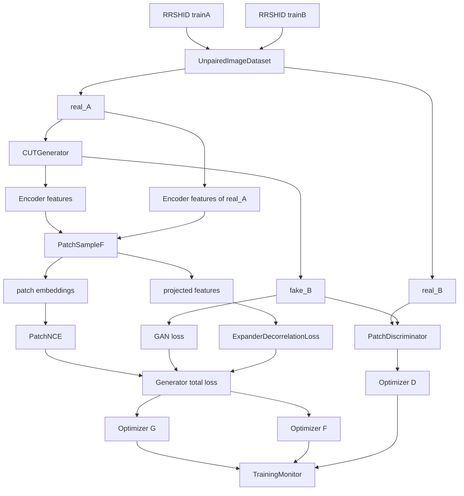

# 项目架构与工作总览

本文档整理当前 Decorrelation 项目的代码架构、训练目标、Expander 去相关方案、实验演进和复现注意事项。它描述的是仓库当前实现；`confirm`、`G_2` 等历史实验可能使用过旧版本代码和旧配置，不能直接视为当前默认配置。

## 1. 项目目标

项目基于 CUT（Contrastive Unpaired Translation）框架，使用非配对的 A/B 图像训练图像转换模型。当前数据任务是 RRSHID 数据集上的图像复原/去退化方向实验。

核心目标有两层：

1. 使用 GAN 重建目标域图像，并通过 PatchNCE 保持输入图像的局部内容结构。
2. 在 PatchNCE 使用的 Expander 投影空间中，惩罚 batch 内不同通道之间的协方差，减少投影表示的线性冗余。

当前去相关实验只研究通道级二阶统计约束，不声称已经实现了显式的 content/degradation disentanglement。

## 2. 总体架构



代码职责如下：

| 路径 | 职责 |
| --- | --- |
| `data/unpaired_dataset.py` | 从 trainA/trainB 独立采样非配对图像，完成 resize、crop、翻转和可选弱退化 |
| `model/backbone.py` | 归一化层、卷积辅助函数、ResNet block 等基础组件 |
| `model/encoder.py` | 输入图像编码、两次下采样和残差块特征导出 |
| `model/decoder.py` | bottleneck 解码、上采样和 RGB 图像生成 |
| `model/network.py` | 组合 Encoder 和 Decoder，提供统一的 `CUTGenerator` 接口 |
| `model/discriminator.py` | PatchGAN 判别器 |
| `model/feature.py` | Patch 抽样、Expander MLP、L2 normalization |
| `utils/loss.py` | GAN、PatchNCE、多层 PatchNCE 和 Expander 去相关损失 |
| `train.py` | 训练循环、优化器、AMP、学习率、损失聚合和评估 |
| `utils/training.py` | CSV、文本日志、latest/best checkpoint 持久化 |
| `analyze_features.py` | 离线统计 projected feature 的协方差和相关性 |
| `Slurm/train.slurm` | GPU 集群作业入口 |

## 3. 生成器结构

当前生成器由 Encoder 和 Decoder 组成：

```text
RGB input [B, 3, H, W]
    -> 7x7 stem convolution
    -> downsample_1
    -> downsample_2
    -> encoder residual blocks
    -> bottleneck [B, 256, H/4, W/4]
    -> decoder residual blocks
    -> upsample_1
    -> upsample_2
    -> output convolution + Tanh
    -> fake_B [B, 3, H, W]
```

当前默认配置来自 `config.py`：

```text
ngf = 64
encoder_blocks = 6
decoder_blocks = 4
downsample_mode = antialias
upsample_mode = antialias
normalization = instance normalization
```

训练阶段 `train.py` 会从 Encoder 导出以下 PatchNCE 特征：

```text
stem
downsample_1
downsample_2
enc_resblock_1
enc_resblock_6
```

实际使用的最后一层由 `encoder_blocks` 决定，因此当 block 数为 6 时，最后一层是 `enc_resblock_6`。

## 4. PatchSampleF 与 Expander

每个选中的 Encoder feature map 独立经过 patch 抽样和 Expander：

```text
feature map [B, C, H, W]
    -> spatial patch sampling
    -> sampled [B x P, C]
    -> Linear(C, 256)
    -> ReLU
    -> Linear(256, 256)
    -> projected [B x P, 256]
    -> L2 normalize
    -> embedding [B x P, 256]
```

设输入 patch 为 $x$，Expander 的两个输出分别为：

$$
z = W_2\operatorname{ReLU}(W_1x+b_1)+b_2,
$$

$$
\hat z = \frac{z}{\lVert z\rVert_2}.
$$

两种表示的用途不同：

| 表示 | 用途 | 是否归一化 |
| --- | --- | --- |
| `projected` | 协方差去相关、方差下界和离线统计 | 否 |
| `embedding` | PatchNCE query/key | 是，L2 normalization |

不把主 variance loss 直接施加到 `embedding` 上，因为逐样本归一化会改变通道方差的含义。

## 5. PatchNCE 与梯度边界

训练使用相同的 patch id 对 fake 和 real_A 进行采样：

1. `fake_B` 经 Encoder 得到 fake features。
2. fake features 经 `PatchSampleF` 得到 `fake_embeddings`、`fake_projected` 和 `patch_ids`。
3. `real_A` 的对应 feature 使用相同 `patch_ids` 得到 `real_embeddings`、`real_projected`。
4. `real_embeddings` 在 PatchNCE 中作为 key 并 detach。
5. `real_projected` 不 detach，继续参与去相关损失并反向更新共享 Encoder 和 Expander。

梯度边界如下：

```text
fake projected       -> 有梯度 -> Generator Encoder + Expander
real projected       -> 有梯度 -> Generator Encoder + Expander
real embedding key   -> detach -> 仅作为 PatchNCE target
discriminator        -> 冻结    -> Generator 更新阶段不接收梯度
```

因此不能用覆盖整个 real 分支的 `torch.no_grad()`，否则 real_A 的去相关项将无法更新模型。

## 6. Expander 去相关损失

### 6.1 统计对象

对每个选定层单独统计。设某层 projected feature 为：

$$
Z_l \in \mathbb{R}^{N \times d}, \qquad N=B\times P, \qquad d=256.
$$

当前默认统计层为 `enc_resblock_6`，默认分支为 `fake,real_a`。

### 6.2 协方差项

先对 batch 内 patch 样本中心化：

$$
\widetilde Z_l = Z_l - \frac{1}{N}\sum_{n=1}^{N}Z_{l,n},
$$

$$
C_l = \frac{\widetilde Z_l^{\mathsf T}\widetilde Z_l}{N-1}.
$$

只惩罚非对角元素：

$$
\mathcal{L}_{cov}^{(l)} =
\frac{1}{d(d-1)}\sum_{i\ne j}C_{l,ij}^2.
$$

### 6.3 方差下界项

为了避免模型将所有 projected 通道缩小，加入弱方差下界：

$$
\sigma_{l,i}=\sqrt{C_{l,ii}+\varepsilon},
$$

$$
\mathcal{L}_{var}^{(l)} =
\frac{1}{d}\sum_i\max(0,\sigma_{min}-\sigma_{l,i})^2.
$$

### 6.4 分支和层聚合

fake 与 real_A 分支的损失取平均；多层时先逐层计算，再对层取平均：

$$
\mathcal{L}_{cov} = \frac{1}{|S|}\sum_{l\in S}
\frac{\mathcal{L}_{cov}(Z_{l,fake})+
\mathcal{L}_{cov}(Z_{l,real_A})}{2}.
$$

方差项同理。最终去相关损失为：

$$
\mathcal{L}_{decorr} =
\lambda_{cov}(e)\mathcal{L}_{cov}+
\lambda_{var}(e)\mathcal{L}_{var}.
$$

协方差、相关性和特征统计在 AMP 训练时强制使用 float32。这样可以避免 CUDA 上 `torch.linalg.eigvalsh` 的 half 类型不支持问题。

## 7. 总训练目标与训练步骤

生成器总损失为：

$$
\mathcal{L}_G = \lambda_G\mathcal{L}_{GAN}
 + \lambda_{NCE}\mathcal{L}_{NCE}
 + \mathcal{L}_{decorr}.
$$

一次训练 step 的主要顺序：

1. 从数据集读取 `real_A` 和 `real_B`。
2. 生成 `fake_B`；如果 identity NCE 到期，同时生成 `idt_B`。
3. 解冻判别器，计算真实/伪造图像的 LSGAN loss，更新判别器。
4. 冻结判别器，计算 fake、real_A 的多层 patch 表示。
5. 计算 PatchNCE、identity NCE 和 Expander 去相关损失。
6. 将所有生成器损失相加，只执行一次 backward。
7. 使用同一次梯度更新 Generator 和 PatchSampleF/Expander。
8. 记录 epoch 平均指标，定期计算 train/test PSNR，并保存 checkpoint。

AMP 只包裹常规网络前向和损失计算；去相关统计内部显式退出 autocast，使用 float32 计算协方差和特征谱统计。

## 8. 当前默认配置

当前 `config.py` 的主要默认值为：

| 参数 | 当前值 |
| --- | ---: |
| `CROP_SIZE` | 256 |
| `BATCH_SIZE` | 16 |
| `NUM_WORKERS` | 8 |
| `N_EPOCHS_CONSTANT` | 25 |
| `N_EPOCHS_COSINE` | 25 |
| `LAMBDA_G` | 1.0 |
| `LAMBDA_NCE` | 1.0 |
| `USE_IDT_NCE` | True |
| `IDT_NCE_INTERVAL` | 4 |
| `NUM_PATCHES` | 256 |
| `USE_EXPANDER_DECORR` | True |
| `EXPANDER_DECORR_LAYERS` | `enc_resblock_6` |
| `EXPANDER_DECORR_BRANCHES` | `fake,real_a` |
| `LAMBDA_EXPANDER_DECORR` | 0.001 |
| `LAMBDA_EXPANDER_DECORR_VAR` | 0.025 |
| `EXPANDER_DECORR_MIN_STD` | 0.5 |
| `EXPANDER_DECORR_WARMUP_EPOCHS` | 10 |
| `USE_AMP` | True |
| `SEED` | 1407 |

去相关权重使用线性 warmup：第 $e$ 个 epoch 的缩放因子为：

$$
s(e)=\min\left(1,\frac{e}{E_{warmup}}\right).
$$

实际协方差和方差权重分别为 `s(e) * LAMBDA_EXPANDER_DECORR` 和 `s(e) * LAMBDA_EXPANDER_DECORR_VAR`。

## 9. 日志和 checkpoint

每个实验目录通常包含：

```text
console.log       Slurm 作业的完整 stdout/stderr
train.log         带时间戳的训练文本日志
train_log.csv     每个 epoch 的数值指标
latest.pt         最近 epoch checkpoint
best_test_psnr.pt 测试 PSNR 最佳 checkpoint
```

当前 CSV 记录：

```text
loss_g
loss_g_gan
loss_d
loss_nce
loss_idt_nce
loss_expander_cov
loss_expander_var
expander_mean_abs_corr
expander_offdiag_energy
expander_mean_std
expander_min_std
expander_effective_rank
expander_pc1_ratio
expander_decorr_weight
lr_g
lr_d
epoch_time_seconds
train_psnr
test_psnr
```

其中：

- `expander_mean_abs_corr` 越低，表示平均通道相关性越弱。
- `expander_offdiag_energy` 越低，表示协方差非对角能量相对对角能量越小。
- `expander_min_std` 用于检查是否存在塌缩通道。
- `expander_effective_rank` 越高，通常表示有效表示维度更充分。
- `expander_pc1_ratio` 过高通常表示方差过度集中在第一主成分。

## 10. 实验演进

### 已完成的方案收敛

1. 初始考虑在 GAP 特征上做 decorrelation，但训练效果不理想，因此放弃作为主方案。
2. 将约束位置转移到 Expander 的最终 `projected` 输出空间。
3. 明确 `projected` 用于统计约束，normalized `embedding` 继续用于 PatchNCE。
4. 选择 fake + real_A 作为主分支，保证共享 Expander 空间受到约束。
5. 将 first hidden、fake-only 和 normalized output 保留为后续消融。
6. 修复 AMP 下协方差统计被降为 half 后调用 CUDA `eigvalsh` 的问题。
7. 修复训练调用中已筛选 decorrelation 层却误传全部层的问题。

### 历史实验解释

`confirm` 和 `G_2` 的模型规模及主要训练超参数基本相同，但它们的历史 CSV 没有 `loss_expander_cov` 等新字段，因此属于旧版训练记录，不能用来判断当前去相关损失的开销。

两者 epoch 时间差异很大：`confirm` 约 45 秒，`G_2` 前段约 90 秒、后段约 66 秒。由于作业使用 `gpushare:1`，更可能是 GPU 分片、节点、共享资源或 CPU/DataLoader 争用差异，而不是网络结构差异。

## 11. Slurm 运行注意事项

当前作业脚本使用：

```text
partition = gpu
gres = gpushare:1
cpus-per-task = 10
mem = 48G
num_workers = 8
AMP = enabled
```

为了比较不同实验的训练速度，建议额外记录：

```bash
SLURM_JOB_ID
SLURM_JOB_NODELIST
SLURM_JOB_GPUS
SLURM_JOB_GRES
hostname
nvidia-smi --query-gpu=index,name,uuid,memory.total,memory.used,utilization.gpu,clocks.current.sm --format=csv
```

公平比较时应尽量固定节点、GPU 类型、资源申请方式和训练命令，并确认 CSV header 包含当前版本的 Expander 指标。

## 12. 当前边界与后续实验

当前实现解决的是“投影表示的通道级线性去相关”，尚未解决以下问题：

- 去相关是否真的对应内容和退化因素解耦；
- `Cov(A,t)` 等内容/退化变量交叉协方差；
- 输出方差是否主要由退化因素驱动；
- 去相关是否提升最终复原质量，而不仅是改善表示统计；
- 不同层、不同分支和不同权重之间的稳定性。

建议后续按以下顺序开展：

1. 先比较 baseline 与当前 `fake + real_A` 主方案的 PSNR、LPIPS/视觉质量和表示统计。
2. 做 `fake-only`、first hidden、不同 decorrelation layer 的消融。
3. 扫描 covariance/variance 权重，确认 variance 项不会压过 PatchNCE。
4. 分析 projected 特征的协方差、有效秩和主成分集中度。
5. 在硬件和 Slurm 资源可比的条件下比较 epoch time。
6. 只有在二阶统计结果稳定后，再研究显式 content/degradation disentanglement。

## 13. 常用验证

修改训练或损失代码后，建议依次执行：

```bash
python -m compileall -q utils/loss.py train.py
git diff --check
```

GPU 环境下至少运行一次包含 AMP 的去相关 smoke test，确认：

```text
projected 可以是 float16
协方差统计在 float32 中完成
eigvalsh 不再触发 linalg_eigh_cuda half 错误
loss、统计量均为有限值
```

提交完整实验前，检查输出目录中的 `train.log` 和 `train_log.csv`，确认命令行参数、模型参数量、去相关字段和实际 epoch 时间均已写入。
